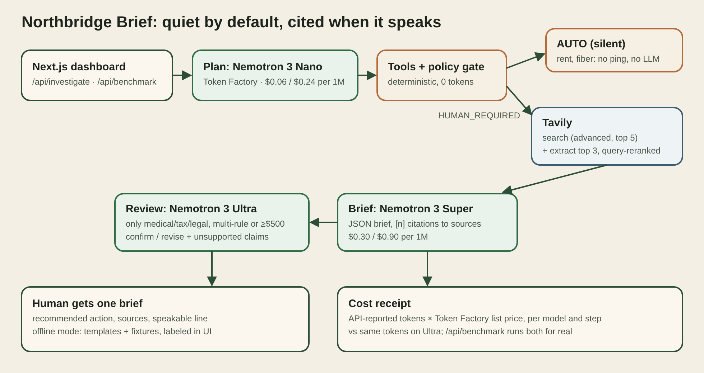

# Northbridge Brief

A quiet household agent built for the **Nebius × NVIDIA Global AI Hackathon** (Best Apps and Agents). Routine bills are handled silently. When a real decision is needed, it writes one short brief with cited web sources, and shows which NVIDIA Nemotron model did each step and what it cost.

The demo household (Avery & Morgan) and all bills are fictional.

- **Live app:** https://northbridge-nebius-brief.vercel.app
- **Pitch deck:** [docs/pitch-deck.pdf](docs/pitch-deck.pdf)
- **Architecture:** [docs/architecture.md](docs/architecture.md)

[](LICENSE)

> **Current deployment status:** the live URL runs in **offline demo mode** until Token Factory and Tavily keys are added to the deployment. The UI shows a banner saying so. In offline mode, plans and briefs come from templates, sources are labeled fixtures, and no costs are shown. The live code path is implemented and tested with mocked APIs (see [Tests](#tests)). Check the mode yourself at [`/api/health`](https://northbridge-nebius-brief.vercel.app/api/health).

---

## Try it in 30 seconds

Open the live app and press **Run the demo**. The page:

1. checks six bills against deterministic rules (rent and fiber are auto-handled, no tokens spent),
2. opens the highest-stakes escalation (a dental bill) as a brief with numbered sources,
3. shows the agent trace: every step, the model or tool that ran it, tokens, latency and cost.

Or locally:

```bash
git clone https://github.com/dl88jing/northbridge-nebius-brief.git
cd northbridge-nebius-brief
./demo.sh          # one command: installs deps, runs the agent end to end in the terminal
./demo.sh dev      # dashboard at http://127.0.0.1:3000
npm test           # unit + agent tests, no keys or network needed
```

To run live, copy `.env.example` to `.env.local` and set `NEBIUS_API_KEY` and `TAVILY_API_KEY`.

---

## How the sponsors' platforms are used



| Step | Runs on | Why |
|------|---------|-----|
| Policy gate (AUTO vs HUMAN_REQUIRED) | Deterministic rules | Money decisions should not depend on a model. Zero tokens. |
| Investigation plan | `nvidia/NVIDIA-Nemotron-3-Nano-30B-A3B` on Token Factory | Cheapest model for a short plan. |
| Web research | Tavily `/search` (advanced, top 5) + `/extract` on the top 3 pages, reranked against the question | The brief can quote real passages, not just snippets. |
| Decision brief | `nvidia/nemotron-3-super-120b-a12b` on Token Factory | JSON brief; every factual claim cites `[n]` from the sources. |
| Escalation review | `nvidia/Nemotron-3-Ultra-550b-a55b` on Token Factory | Only for high-stakes escalations (medical/tax/legal, multiple rules, or ≥ $500). Confirms or revises the recommendation and lists unsupported claims. |

**Cost receipt.** Every Token Factory call records the API-reported `prompt_tokens` and `completion_tokens`, multiplied by Token Factory list prices (public catalog, read 2026-10-25, in [`lib/pricing.ts`](lib/pricing.ts)). The UI shows cost per step and per model, plus what the same tokens would cost on Ultra. That second number is a repricing, not a second run, and is labeled that way. For a measured comparison, `POST /api/benchmark` runs the routed pipeline and an all-Ultra pipeline side by side and returns both real costs. Tavily credits come from the API's `usage` field.

No cost or savings figures are shown in offline mode, and none are claimed in this README, because the deployment has not run live yet.

Models and endpoint can be overridden with `NEMOTRON_FAST_MODEL`, `NEMOTRON_REASON_MODEL`, `NEMOTRON_ULTRA_MODEL`, `NEBIUS_BASE_URL` (default `https://api.tokenfactory.us-central1.nebius.com/v1/`, falls back to `https://api.tokenfactory.nebius.com/v1/`).

---

## Modes

| Mode | When | What you see |
|------|------|--------------|
| `live` | Both keys set | Real Nemotron output, real Tavily sources, measured cost receipt. Green banner. |
| `partial` | One key set | Live part is real, the other part is labeled offline. Amber banner. |
| `offline` | No keys | Templates + fixture sources (example.com links), no costs. Amber "OFFLINE DEMO" banner. If a live call fails, the step is marked "[fallback]" with the error. |

`GET /api/health` reports the mode and which keys are present (booleans only). `GET /api/health?probe=1` makes one tiny Token Factory call and one Tavily search and reports success and latency.

---

## API

| Endpoint | Purpose |
|----------|---------|
| `GET /api/health` | Mode, key presence, models. `?probe=1` for a live check. |
| `GET /api/status` | Household, bills, briefs, last trace and receipt |
| `POST /api/investigate` | Run the agent (`{ goal?, billIds?, reset? }`) |
| `POST /api/benchmark` | Live only: routed vs all-Ultra, measured side by side |
| `GET/POST /api/brief` | Read or regenerate one brief |
| `POST /api/reset` | Clear runtime state |

---

## Tests

`npm test` (Node's test runner via `tsx`), no keys or network:

- policy decisions on all six fixture bills,
- pricing math and receipt (only measured calls count; Ultra repricing),
- JSON extraction from model output with `<think>` blocks and code fences,
- offline run: zero network calls, every research step labeled OFFLINE, no cost reported, every brief has sources,
- live path with a fake Token Factory client and fake Tavily server: Nano plans, Super briefs, Ultra reviews the dental bill, citations point at Tavily URLs, receipt is measured, Tavily credits add up,
- `/api/status` never contains key values.

`npm run check` runs typecheck, lint and tests.

---

## Limitations

- **Not live yet on the public URL.** Keys have not been added to the deployment, so the hosted demo is offline. Everything shown there is labeled.
- **Fixture data.** Six fictional bills; no bank, email or biller integration. Nothing is ever paid.
- **Rules are simple.** Expected-amount bands and duplicate detection are hand-set per bill.
- **Prices are list prices** copied on 2026-10-25; Token Factory may change them. Unknown models show "n/a" instead of a guess.
- **State is per server instance** (`/tmp` on Vercel), so runs are not shared between visitors reliably.
- **Ultra review adds latency** (it is the largest model), which is why it only runs on high-stakes escalations.

## Accessibility (current and next)

Current: semantic headings, `role="status"` mode banner, `aria-live` run summary, labeled inputs, a table caption for the receipt, and text labels next to every color pill.

Next: keyboard focus styles audit, reduced-motion support for scrolling, a screen-reader pass with VoiceOver/NVDA, and reading the speakable brief aloud with TTS.

---

## Repo layout

```
app/                Next.js App Router UI + API routes
lib/agent.ts        Agent loop: plan → tools → policy → research → brief → Ultra review → receipt
lib/llm.ts          Token Factory client, usage + latency capture
lib/pricing.ts      Token Factory list prices
lib/tavily.ts       Tavily search + extract
lib/nemotron.ts     Plan, cited brief, Ultra review, offline templates
data/               Fictional household fixtures + offline research
tests/              node:test suites
scripts/demo.ts     Terminal demo (./demo.sh)
docs/               Architecture (SVG/PNG/MD), pitch deck
```

---

## Feedback for Nebius, NVIDIA and Tavily

- **Token Factory:** the OpenAI-compatible API meant the live path is one client with a different base URL. Returning `usage` on every call made the per-step cost receipt easy. It took searching to learn that models live in different regions (Nano in eu-north1, Super/Ultra in us-central1) with different base URLs; one endpoint that routes by model, or a clear region column in the catalog, would save time. A machine-readable price list exists at `/api/public/models_info`, which we used; linking it from the docs would help.
- **Nemotron:** Nano → Super → Ultra is a natural ladder for agents. Some responses include reasoning text before the JSON, so we strip `<think>` blocks. A documented "JSON only" switch per model would remove that step.
- **Tavily:** `search` + `extract` with `query` reranking and `chunks_per_source` gives short, relevant passages that fit in a brief prompt. `include_usage` for credits is great for showing cost. An option to have search return the extracted chunks directly would save one round trip.

## License

Apache-2.0. See [LICENSE](LICENSE).
