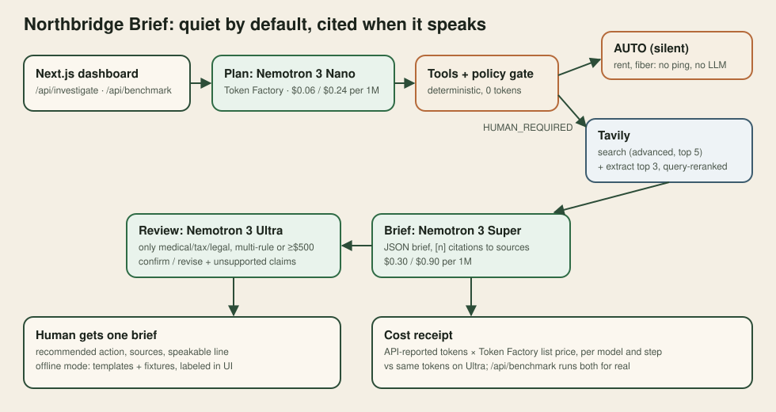
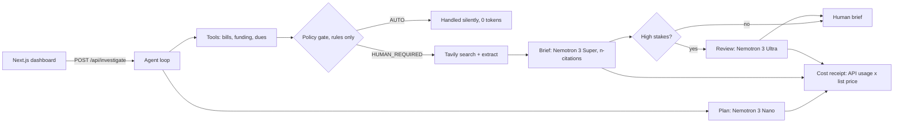

# Northbridge Brief: architecture

## Flow

## Components

| File | Role |
|------|------|
| `lib/agent.ts` | Orchestrates one run; records model, tokens, latency per step; builds the receipt |
| `lib/policy.ts` | Deterministic AUTO / HUMAN_REQUIRED rules: amount band, duplicate, sensitive category, funding floor |
| `lib/tavily.ts` | `/search` (advanced, 5 results) then `/extract` on the top 3 with `query` reranking; labeled fixture fallback |
| `lib/nemotron.ts` | Plan prompt, cited brief prompt (JSON), Ultra review prompt; offline templates |
| `lib/llm.ts` | OpenAI-compatible Token Factory client; regional base URL with global fallback; usage capture |
| `lib/pricing.ts` / `lib/receipt.ts` | List prices (2026-10-25) and receipt math; only measured calls count |
| `app/api/benchmark` | Runs routed and all-Ultra pipelines in parallel for a measured comparison |
| `app/api/health` | Mode and key presence; `?probe=1` live check |

## Ultra review trigger

`needsUltraReview` is true when a bill is HUMAN_REQUIRED and any of: two or more rules fired, the category is medical/tax/legal, or the amount is at least $500. In the fixtures that is the dental bill.

## Honesty rules in code

- Offline steps are titled "OFFLINE fixture" / "template (no model call)".
- Failed live calls fall back and show "[fallback]" plus the error.
- Receipts with no API usage are `measured: false` and the UI shows no cost.
